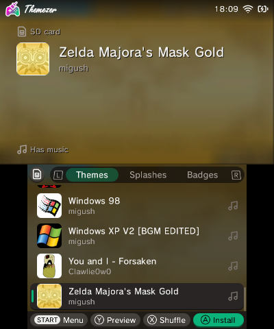
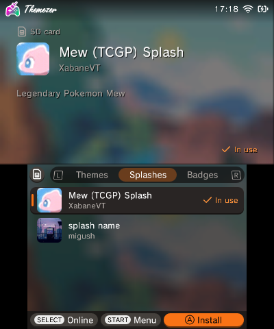
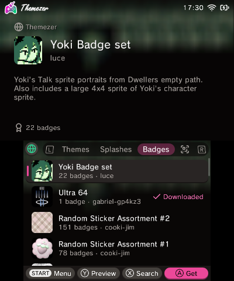

# Themezer-3DS

The theme manager for the Nintendo 3DS by [Themezer](https://themezer.net). Install themes, splash screens and
badges from your SD card, or find new ones on Themezer or [ThemePlaza](https://themeplaza.art) and install them
straight away: browse and search them, scan an item's QR code, or type its ID.

<p>
  
  
  
</p>

Themezer-3DS is based on [Anemone3DS](https://github.com/astronautlevel2/Anemone3DS), rewritten from scratch.

## Compared with Anemone3DS

What you'll notice coming from Anemone3DS 3.0.1, its latest release:

| | Themezer-3DS | Anemone3DS |
| --- | --- | --- |
| Starting | Opens at once, and reads the SD card while you look around | Reads every theme and splash behind a loading screen first |
| Previews | Load without holding up the app, and the last few stay loaded, so going back is instant | Read from the zip and decoded again for each item, while the app waits |
| Downloads | Faster: saved straight to the SD card, over connections kept open | Held in memory until the whole file is in |
| QR codes | Picked up quicker, read with ZXing-cpp on the camera's own thread | Read with quirc between the app's frames |
| Online | Themezer and ThemePlaza: search, sort, or type an item's ID | ThemePlaza: search |
| Online pages | Show at once, their icons following | Wait for every item's icon first |
| A console that never had a theme | Sets up the HOME Menu's theme storage itself | Asks you to pick a theme in the HOME Menu first |
| Splash screens | Turns Luma3DS's splashes on when you install one | Leaves that to Luma3DS's settings |
| Updates | Updates itself from GitHub | By hand |
| Sound | Background music and UI sounds | Silent, except a theme's music in its preview |

## Installing

- **CIA:** install `themezer-3ds.cia` from the
  [latest release](https://github.com/ThemezerNX/themezer-3ds/releases/latest), for example with FBI. It installs as its
  own app, next to Anemone3DS if you have it.
- **3DSX:** copy `themezer-3ds.3dsx` to `/3ds/` on your SD card and start it from the Homebrew Launcher.

Themes, splash screens and badges are read from `/Themes`, `/Splashes` and `/Badges` on the SD card, the same folders
Anemone3DS uses. The app keeps its settings and caches in `/3ds/themezer-3ds`.

## Building

You need [devkitPro](https://devkitpro.org/wiki/Getting_Started) with devkitARM and these packages:

```sh
dkp-pacman -S 3ds-dev 3ds-curl 3ds-mbedtls 3ds-jansson 3ds-libpng 3ds-zlib
```

and [makerom](https://github.com/3DSGuy/Project_CTR) and [bannertool](https://github.com/diasurgical/bannertool) on
your `PATH`. Then:

```sh
make          # out/themezer-3ds.3dsx and out/themezer-3ds.cia
make test     # unit tests, on your computer
make send     # sends the 3dsx to a 3DS waiting in the Homebrew Launcher (Y)
make preview  # opens the 3dsx in the Azahar emulator
```

[docs/DEVELOPMENT.md](docs/DEVELOPMENT.md) has more: trying the app in an emulator, and the autopilot that walks
through its screens and takes screenshots.

## License

Themezer-3DS is free software: you can redistribute it and/or modify it under the terms of the
[GNU General Public License](LICENSE), version 3 or (at your option) any later version, like Anemone3DS.

The libraries the app is built with keep their own licenses; see [THIRD_PARTY_NOTICES.md](THIRD_PARTY_NOTICES.md).
The app shows these notices on its About screen.

## Credits

Themezer-3DS exists thanks to Anemone3DS and everyone who made it: Alex Taber
([@astronautlevel2](https://github.com/astronautlevel2)) and the [Anemone3DS contributors](CONTRIBUTORS.md).

The file formats the app works with were documented by others before it:

- [3dbrew](https://www.3dbrew.org), for the HOME Menu's theme, badge and extdata formats.
- [yellows8](https://github.com/yellows8)'s [3ds_homemenu_extdatatool](https://github.com/yellows8/3ds_homemenu_extdatatool),
  for the theme cache.
- [MrCheeze](https://github.com/MrCheeze)'s [GYTB](https://github.com/MrCheeze/GYTB) and
  [AntiMach](https://github.com/AntiMach)'s [Advanced Badge Editor](https://github.com/AntiMach/advanced-badge-editor),
  for the badge files.
- [Luma3DS](https://github.com/LumaTeam/Luma3DS), for its splash screens.

The banner, boot animation, tune and background music are Themezer's own; [meta/README.md](meta/README.md) describes
how they were made and how to rebuild them.
